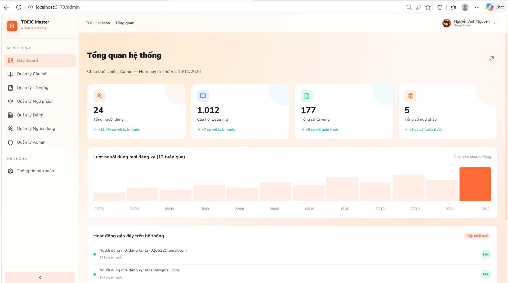
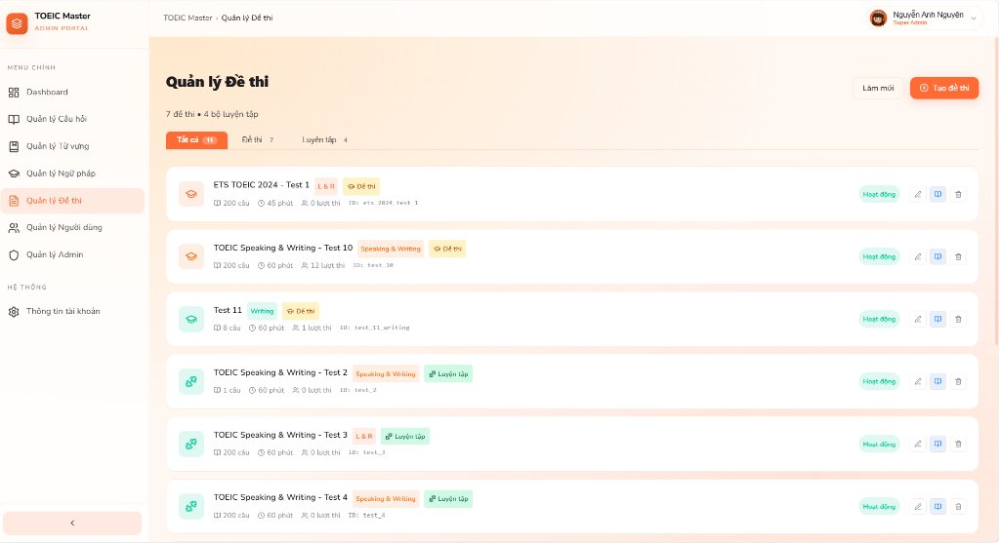
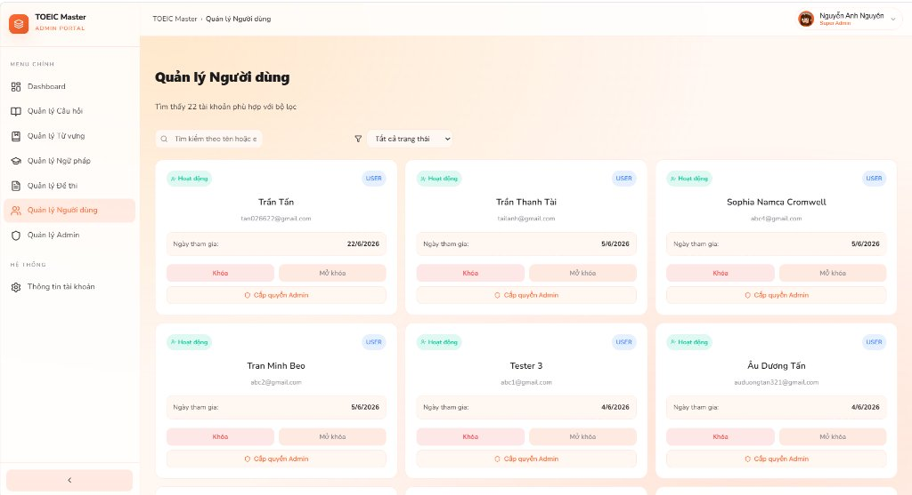

# 💻 TOEIC Learning Platform — Web Admin Portal (ReactJS)

[](https://react.dev/)
[](https://vitejs.dev/)
[](https://redux-toolkit.js.org/)
[](https://firebase.google.com/)
[](https://vercel.com/)
[](LICENSE)

> Cổng thông tin quản trị trung tâm (Web Admin Portal) phục vụ hệ sinh thái luyện thi TOEIC 4 kỹ năng. Ứng dụng cung cấp bảng điều khiển thống kê (Dashboard Analytics), hệ thống quản lý ngân hàng câu hỏi (QBank CRUD), tạo và chỉnh sửa đề thi linh hoạt, công cụ import dữ liệu hàng loạt từ file Excel/CSV và quản lý phân quyền người dùng/quản trị viên.

---

## 🌐 Hệ Sinh Thái Dự Án (Ecosystem Repositories)

Hệ thống được thiết kế theo kiến trúc Client-Server đồng bộ giữa 3 thành phần:

* 🚀 **Backend API (.NET 9):** [https://github.com/TranMinhTan3110/toeic-backend-api](https://github.com/TranMinhTan3110/toeic-backend-api)  
  *Core RESTful API, Clean Architecture, Firestore NoSQL, Hybrid AI Engine (Gemini & OpenAI), Docker, AWS EC2.*
* 📱 **Mobile Client (Flutter):** [https://github.com/TranMinhTan3110/toeic-mobile-app](https://github.com/TranMinhTan3110/toeic-mobile-app)  
  *Ứng dụng di động luyện thi 4 kỹ năng TOEIC, học từ vựng SRS và bảng xếp hạng Leaderboard.*
* 💻 **Web Admin Portal (ReactJS):** [https://github.com/TranMinhTan3110/toeic-web-app](https://github.com/TranMinhTan3110/toeic-web-app) *(Repo này)*  
  *Trang web quản trị dành cho Quản trị viên và Giáo viên.*

---

## 📸 Giao Diện Quản Trị (Admin Portal Screenshots)

<div align="center">
  <table style="border: none;">
    <tr>
      <td align="center"><br/><b>Dashboard & Thống kê tăng trưởng</b></td>
      <td align="center"><br/><b>Quản lý QBank 4 kỹ năng</b></td>
    </tr>
    <tr>
      <td align="center"><br/><b>Tạo & Soạn thảo đề thi</b></td>
      <td align="center"><br/><b>Quản lý tài khoản & Phân quyền</b></td>
    </tr>
  </table>
</div>

> *Tip: Chụp ảnh màn hình thực tế của Web Admin đặt vào thư mục `docs/screenshots/` theo đúng tên trên để ảnh tự động hiển thị trên GitHub!*

---

## ✨ Tính Năng Nổi Bật (Key Features)

### 1. 📊 Bảng Điều Khiển Thống Kê (Dashboard Analytics)
* Hiển thị số lượng học viên, số lượt thi và tăng trưởng tài khoản đăng ký mới theo tuần.
* Biểu đồ tương tác mượt mà với tooltip chi tiết và hiệu ứng khung xương (Shimmer loading) khi tải dữ liệu.

### 2. 📚 Ngân Hàng Câu Hỏi (Question Bank Management - QBank)
* Quản lý tập trung toàn diện câu hỏi cho cả 4 kỹ năng: **Listening (Part 1 - 4)**, **Reading (Part 5 - 7)**, **Speaking** và **Writing**.
* Thao tác CRUD trực quan: Xem trước nội dung, phát thử file audio nghe, hiển thị hình ảnh câu hỏi và đáp án giải thích chi tiết.

### 3. 📝 Soạn Thảo & Quản Lý Đề Thi (Exam Manager & Editor)
* Tạo mới các bộ đề thi thử (Exam Sets) theo cấu trúc chuẩn TOEIC ETS.
* Ghép câu hỏi từ ngân hàng câu hỏi vào từng Part của đề thi dễ dàng.

### 4. 📥 Tải Lên Hàng Loạt Từ Excel / CSV (Bulk Import)
* Hỗ trợ tải file bảng tính Excel/CSV theo mẫu chuẩn có sẵn để import hàng trăm câu hỏi cùng lúc, giảm thiểu 90% thời gian nhập liệu thủ công.

### 5. 👥 Quản Lý Người Dùng & Phân Quyền (RBAC & User Management)
* Quản lý danh sách học viên và quản trị viên trong hệ thống.
* Chức năng phân quyền linh hoạt: Thăng cấp thành viên lên Admin hoặc hạ quyền về Student với hộp thoại xác nhận an toàn qua **SweetAlert2**.

---

## 🛠️ Công Nghệ Sử Dụng (Tech Stack)

* **Thư viện giao diện chính:** [React 18](https://react.dev/)
* **Công cụ xây dựng & Bundler:** [Vite 5](https://vitejs.dev/) (Khởi động tức thì với Hot Module Replacement - HMR).
* **Quản lý trạng thái (State Management):** `@reduxjs/toolkit` & `react-redux`.
* **Điều hướng (Routing):** `react-router-dom` v6.
* **Kết nối API (HTTP Client):** `axios` (cấu hình interceptor đính kèm Firebase JWT token).
* **Xác thực:** `firebase` SDK (Authentication & Role Verification).
* **Icons & UI Feedback:** `lucide-react`, `sweetalert2`.
* **Triển khai Cloud:** [Vercel](https://vercel.com/) (hỗ trợ rewrite SPA routing qua `vercel.json`) và **Firebase Hosting** (`firebase.json`).

---

## 📁 Cấu Trúc Thư Mục (Project Architecture)

```
src/
├── assets/                  # Hình ảnh, logo, tài nguyên tĩnh
├── components/              # Các UI Component tái sử dụng
│   ├── common/              # Button, Input, Modal, Shimmer Loader
│   └── layout/              # Sidebar điều hướng, Header, AdminLayout
├── contexts/                # React Contexts (AuthContext quản lý phiên đăng nhập)
├── pages/                   # Các màn hình chức năng chính
│   ├── Admin/               # Dashboard, AdminsPage, UsersPage
│   ├── Auth/                # Login, Register, Forgot Password
│   ├── Exam/                # ExamManager, ExamEditor
│   └── QBank/               # QBankPage (Listening, Reading, Speaking, Writing)
├── services/                # Tầng giao tiếp API Backend & Firebase SDK
│   ├── api.js               # Cấu hình Axios Base URL & Interceptors
│   ├── authService.js       # Xác thực người dùng qua Firebase Auth
│   ├── examService.js       # API đề thi kết nối với Backend ASP.NET
│   └── qbankService.js      # API ngân hàng câu hỏi
├── store/                   # Redux Toolkit Slices (Quản lý state phức tạp)
└── utils/                   # Helpers, format ngày tháng, cấu hình Firebase
```

---

## 🚀 Hướng Dẫn Cài Đặt & Chạy Dưới Local (Getting Started)

### 1. Yêu Cầu Môi Trường
* Đã cài đặt [Node.js](https://nodejs.org/) (phiên bản v18 trở lên).
* Trình quản lý gói `npm` hoặc `yarn`.

### 2. Clone Dự Án
```bash
git clone https://github.com/TranMinhTan3110/toeic-web-app.git
cd toeic-web-app
```

### 3. Cài Đặt Thư Viện
```bash
npm install
```

### 4. Cấu Hình Môi Trường (.env)
Tạo file `.env` tại thư mục gốc:

```env
# Địa chỉ Backend API (.NET) đang chạy local:
VITE_API_BASE_URL=http://localhost:8080/api

# Cấu hình Firebase Web (lấy từ Firebase Console):
VITE_FIREBASE_API_KEY=YOUR_FIREBASE_API_KEY
VITE_FIREBASE_AUTH_DOMAIN=toeic-80ff0.firebaseapp.com
VITE_FIREBASE_PROJECT_ID=toeic-80ff0
VITE_FIREBASE_STORAGE_BUCKET=toeic-80ff0.appspot.com
VITE_FIREBASE_MESSAGING_SENDER_ID=YOUR_SENDER_ID
VITE_FIREBASE_APP_ID=YOUR_APP_ID
```

### 5. Khởi Chạy Local Development
```bash
npm run dev
```

* Mở trình duyệt truy cập: **`http://localhost:5173`**

---

## 👥 Thành Viên Phát Triển (Team)

Dự án được xây dựng bởi nhóm 5 thành viên:
* **Trần Minh Tấn ([@TranMinhTan3110](https://github.com/TranMinhTan3110))** — *Team Leader & Full-flow Integrator*
* **Nhóm phát triển Frontend:** Phụ trách giao diện ReactJS, biểu đồ Dashboard và các form quản lý câu hỏi.

---

## 📄 License
Phát hành theo giấy phép [MIT License](LICENSE).
